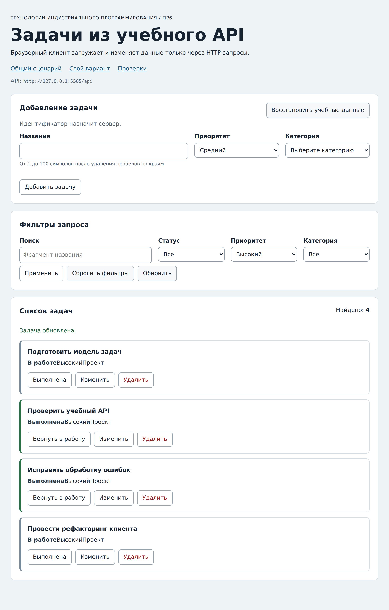

# Отчёт по практической работе № 6

**Тема:** Подключение браузерного приложения к API<br>
**Автор:** Бочко Никита Сергеевич<br>
**Группа:** ЭФБО-05-25<br>
**Вариант:** 3, начальный фильтр `priority=high`

## 1. Цель работы

Связать браузерный интерфейс с настоящим HTTP-API: научиться выполнять не только чтение, но и создание, изменение и удаление записей, держать источником истины сервер, а не состояние страницы, и корректно вести себя при ошибках, тайм-аутах и устаревших ответах.

Результат: приложение, которое загружает задачи и категории параллельно, фильтрует их серверными запросами, создаёт и редактирует задачи через одну форму, переключает статус и удаляет записи, восстанавливает учебный набор и во всех случаях перечитывает список у API. Ничего не хранится в `localStorage`.

## 2. Запуск

**Версии:**

```text
node --version: v22.23.2
npm --version:  10.9.8
```

**Команда запуска:**

```bash
npm start
```

**Адрес приложения:** `http://127.0.0.1:5506/`<br>
**Адрес API:** `http://127.0.0.1:5505/api`

Порты по умолчанию не менялись. Индивидуальный сценарий открывается по `http://127.0.0.1:5506/index.html?dataset=variant`, браузерные проверки - по `http://127.0.0.1:5506/checks.html`. Полный набор проверок Node.js: `npm test`.

## 3. Реализация

### 3.1. HTTP-клиент

`src/api-client.js` перенесён из ПР5 и расширен. `requestJson(path, { method, query, body, signal, timeoutMs })` допускает только `GET`, `POST`, `PATCH` и `DELETE`, метод нормализуется в верхний регистр, поэтому `"patch"` работает так же, как `"PATCH"`. Тело у `GET` и неизвестный метод отклоняются `TypeError` до сетевого запроса.

`Accept: application/json` добавляется всегда. `Content-Type: application/json` добавляется только при наличии тела, и тело сериализуется через `JSON.stringify`; у `GET` заголовка `Content-Type` нет вовсе. Тайм-аут реализован через `AbortSignal.timeout`, внешняя отмена объединяется с ним через `AbortSignal.any`, и вид ошибки определяется по тому, какой сигнал оказался отменён: сначала проверяется внешний, затем сигнал тайм-аута.

Порядок разбора ответа важен: сначала проверяется `response.ok`, и только для успешного ответа - `204`, затем `Content-Type`, затем JSON. Поэтому ответ `502 text/plain` остаётся ошибкой `http` со статусом, а не превращается в `invalid-response`. Виды ошибок сохранены из ПР5: `http`, `network`, `invalid-response`, `timeout`, `aborted`.

### 3.2. Доменный API

`src/task-api.js` знает про задачи, но ничего не знает про DOM и про `fetch`. Реализованы `getTasks`, `getTaskById`, `getCategories`, `loadInitialData`, `createTask`, `updateTask`, `setTaskCompleted`, `deleteTask` и `resetDemoData`; последним аргументом каждый метод принимает `{ signal }` и передаёт его общему клиенту.

Фильтры проверяются до запроса: разрешены только `completed`, `priority`, `categoryId` и `q`, строка поиска обрезается по краям, логическое `false` остаётся логическим (в строку его превращает `URLSearchParams`). Схема проверяется после запроса: каждая задача и категория проходит `isTask`/`isCategory`, коллекция - на уникальность id и совпадение `meta.total` с длиной `data`. Для `deleteTask` ожидается строго `null`; любое тело в ответе на удаление считается нарушением контракта. Любое несовпадение превращается в `ApiError` с видом `invalid-response`, данные не «чинятся» на месте.

### 3.3. Состояния интерфейса

Любая загрузка начинается с `loading`. При успехе состояние становится `ready`, если задачи есть, и `empty`, если выборка пуста. При ошибке - `error` с текстом из `messageForError`, и появляется кнопка повтора. Первая загрузка идёт через `loadInitialData` (задачи и категории параллельно), последующие - через `getTasks`. Если первая загрузка упала и категории ещё не получены, повтор снова выполняет `loadInitialData`, иначе в форме не из чего строить список категорий.

Отдельное правило: отказ с видом `aborted` не показывается пользователю. Отмена - это наше собственное решение прервать запрос, а не сбой, и показывать её как ошибку неправильно.

### 3.4. Изменение данных

Все изменяющие операции идут по одной схеме во внутренней функции `mutate`: блокировка действий через `setMutationPending(true)`, вызов метода API, сообщение об успехе, повторная загрузка списка с текущими фильтрами, снятие блокировки в `finally`. При ошибке показывается текст из `messageForError`, список не трогается.

Список после мутации не правится вручную: выполняется новый `GET` с теми же фильтрами. Поэтому задача, переставшая подходить под фильтр, исчезает сама, а `meta.total` и содержимое карточек всегда приходят от сервера. Создание и редактирование используют одну форму: режим определяется полем `editingId`, при `null` вызывается `createTask`, иначе `updateTask` с сохранением `completed` (статус меняется только отдельной операцией `setTaskCompleted`).

### 3.5. Защита от устаревшего ответа

Защиты две, и они дополняют друг друга. Перед новой загрузкой предыдущая отменяется через `AbortController`, поэтому лишний запрос не занимает сеть. Кроме того, у каждой загрузки есть порядковый номер, и результат применяется только если номер совпал с последним: если ответ всё-таки придёт после того, как началась новая загрузка, он будет отброшен и не перепишет список. Одного `AbortController` мало, потому что отмена не мгновенна - ответ может уже лежать в очереди микрозадач.

## 4. Индивидуальный вариант

**Начальный фильтр:** `priority=high` (вариант 3)<br>
**Индивидуальный сценарий:** изменить приоритет видимой задачи на `medium`, карточка должна исчезнуть из выборки.

| Шаг | Действие | Ожидаемый результат | Фактический результат |
|---:|---|---|---|
| 1 | Открыть `/index.html?dataset=variant` | Запрос `GET /api/tasks?priority=high`, 5 задач | id `[4, 13, 16, 25, 34]`, «Найдено: 5», в форме фильтров выбран «Высокий» |
| 2 | Нажать «Изменить» у задачи 13 | Форма переходит в режим редактирования с её данными | Заголовок «Редактирование задачи», название «Разобрать Promise», приоритет «Высокий», кнопка «Сохранить изменения» |
| 3 | Выбрать приоритет «Средний» и сохранить | `PATCH /api/tasks/13`, затем повторный `GET` с тем же фильтром; карточка исчезает | id `[4, 16, 25, 34]`, «Найдено: 4», сообщение «Задача обновлена.» |
| 4 | Проверить задачу на сервере | Приоритет изменён, остальные поля сохранены | `GET /api/tasks/13` вернул `{ id: 13, title: "Разобрать Promise", completed: false, priority: "medium", categoryId: 1 }` |

Задача исчезла из выборки не потому, что её удалили из массива на странице, а потому что после `PATCH` выполнен новый запрос с фильтром `priority=high`, под который она больше не подходит. Это и есть разница между «сервер - источник истины» и локальным редактированием списка.

## 5. Результаты проверок

### 5.1. Автоматизированные проверки Node.js

```text
Итог API: успешно 23, ошибок 0.
Итог модулей: успешно 33, ошибок 0.
Итог интеграции: успешно 14, ошибок 0.
```

Полные протоколы:

```text
OK: 01. health возвращает JSON и заголовки CORS
OK: 02. исходный список содержит 12 задач в контрольном порядке
OK: 03. фильтры и поиск применяются совместно
OK: 04. неверный или повторяющийся query даёт 400
OK: 05. POST создаёт задачу, обрезает title и назначает id
OK: 06. созданная задача доступна по id и в списке
OK: 07. POST требует application/json
OK: 08. повреждённый JSON даёт структурированную ошибку
OK: 09. серверная валидация сообщает ошибки полей
OK: 10. PATCH изменяет только переданные поля
OK: 11. PATCH изменяет completed логическим значением
OK: 12. пустой PATCH и неизвестное поле отклоняются
OK: 13. DELETE возвращает 204 без тела
OK: 14. отсутствующая задача даёт 404 для PATCH и DELETE
OK: 15. неверный id даёт 400
OK: 16. категории доступны отдельным ресурсом
OK: 17. HEAD возвращает заголовки без тела
OK: 18. OPTIONS объявляет CORS для изменяющих методов
OK: 19. неподдерживаемый метод даёт 405 и Allow
OK: 20. отладочные маршруты воспроизводят виды ошибок
OK: 21. слишком большое тело запроса отклоняется
OK: 22. reset восстанавливает данные и счётчик id
OK: 23. два экземпляра API не делят изменяемое состояние

Итог API: успешно 23, ошибок 0.
```

```text
OK: 01. buildUrl соединяет baseUrl, путь и кодированный query
OK: 02. buildUrl не изменяет объект query
OK: 03. createApiClient проверяет конфигурацию
OK: 04. GET отправляет Accept, query и AbortSignal
OK: 05. POST сериализует тело и добавляет Content-Type
OK: 06. PATCH поддерживается, а неизвестный метод и body у GET отклоняются
OK: 07. успешный 204 преобразуется в null
OK: 08. JSON-ошибка HTTP сохраняет поля контракта
OK: 09. HTTP-ошибка важнее неверного Content-Type
OK: 10. неверный Content-Type и повреждённый JSON отклоняются
OK: 11. сетевая ошибка сохраняется как cause
OK: 12. тайм-аут отличается от внешней отмены
OK: 13. createTaskApi требует requestJson
OK: 14. getTasks нормализует фильтры и проверяет ответ
OK: 15. getTasks отклоняет неверные фильтры до запроса
OK: 16. loadInitialData параллельно запрашивает задачи и категории
OK: 17. createTask отправляет POST и проверяет задачу
OK: 18. update и смена статуса отправляют PATCH
OK: 19. deleteTask требует ответ 204, reset проверяет подтверждение
OK: 20. доменный API отклоняет неверную схему ответа
OK: 21. validateTaskDraft нормализует корректные данные
OK: 22. validateTaskDraft возвращает ошибки каждого поля
OK: 23. контроллер проверяет зависимости
OK: 24. start отображает loading, категории, задачи и ready
OK: 25. пустой ответ отображает состояние empty
OK: 26. ошибка загрузки отображается, а aborted не показывается
OK: 27. новая загрузка отменяет предыдущую и игнорирует устаревший ответ
OK: 28. невалидная форма не вызывает API
OK: 29. создание блокирует действия, очищает форму и обновляет список
OK: 30. редактирование, toggle и delete используют id текущей задачи
OK: 31. ошибка мутации показывается и снимает блокировку
OK: 32. reset вызывает сервер и перезагружает текущий фильтр
OK: 33. messageForError не раскрывает внутреннюю ошибку

Итог модулей: успешно 33, ошибок 0.
```

```text
OK: 01. начальная загрузка получает задачи и категории
OK: 02. клиент создаёт задачу и получает назначенный id
OK: 03. созданная задача читается по id
OK: 04. редактирование сохраняется на сервере
OK: 05. созданная задача находится серверным поиском
OK: 06. смена статуса видна через фильтр
OK: 07. DELETE удаляет запись и возвращает null
OK: 08. повторное удаление сохраняет код и детали 404
OK: 09. серверная ошибка валидации доступна клиенту
OK: 10. 204 не вызывает ошибку разбора JSON
OK: 11. реальная задержка прерывается по тайм-ауту
OK: 12. внешний AbortController отменяет реальный запрос
OK: 13. повреждённый JSON и text/plain определяются как invalid-response
OK: 14. reset восстанавливает исходный набор

Итог интеграции: успешно 14, ошибок 0.
```

### 5.2. Браузерные проверки

```text
OK: Карточка содержит безопасный текст и три действия
OK: Повторная отрисовка списка не накапливает карточки
OK: Начальная загрузка показывает 12 задач и 3 категории
OK: Фильтры формируют новый серверный запрос
OK: Поиск без результатов показывает empty, а сброс возвращает список
FAIL: Корректная форма создаёт задачу с серверным id — Не найден элемент: [data-task-id="35"]
FAIL: Ошибки формы не отправляют запрос и связаны с полями — Значения отличаются: получено 13, ожидалось 12
OK: Редактирование заполняет форму и сохраняет изменения
OK: Отмена редактирования возвращает режим создания
OK: Смена статуса подтверждается сервером
OK: Удаление подтверждается и сохраняется на сервере
OK: Сброс восстанавливает учебный набор
OK: Недоступный API показывает error и кнопку повтора
OK: Приложение не использует localStorage как источник данных

Всего: 14. Пройдено: 12. Ошибок: 2.
```

**Разбор двух отказов.** Сама функция создания работает: это подтверждается вручную и отдельным измерением. После отправки корректной формы задача появляется с серверным id `35`, название приходит нормализованным, поле очищается, счётчик становится 13:

```text
карточка [data-task-id="35"] сразу после requestSubmit(): нет
карточка появилась через: 31 мс
название: Подключить браузер
поле формы после отправки: ""
Найдено: 13
сообщение: Задача добавлена.
```

Отказ вызван самой проверкой, а не реализацией. В `checks/browser.checks.js` ожидание записано так:

```js
await waitFor(() => requireNode(doc, '[data-task-id="35"]'), "Задача не появилась");
```

`requireNode` не возвращает `null`, а бросает исключение (`assert(node, ...)`), и первый опрос внутри `waitFor` выполняется синхронно, сразу после `requestSubmit()`. Ответа сервера в этот момент ещё нет ни при какой реализации, поэтому исключение улетает наружу и цикл ожидания ни разу не повторяется - об этом же говорит текст ошибки «Не найден элемент», а не заданное сообщение «Задача не появилась». Соседние проверки с тем же `waitFor` проходят потому, что там элемент уже существует и меняется лишь его содержимое: `requireNode` находит узел и возвращает его, а условие просто остаётся ложным до обновления.

Второй отказ - следствие первого. Проверка создания прерывается до того, как `POST` завершился, запрос долетает до сервера уже после `resetApi()` следующей проверки, и та видит 13 задач вместо 12.

Чтобы убедиться, что дело не в реализации, в копии файла проверок (вне репозитория, сам файл проверок не изменялся) одна строка была заменена на `doc.querySelector`:

```js
await waitFor(() => doc.querySelector('[data-task-id="35"]'), "Задача не появилась");
```

После этого набор даёт `Всего: 14. Пройдено: 14. Ошибок: 0.` В сданной работе файл проверок оставлен в исходном виде.

### 5.3. Ручные проверки

| Сценарий | Ожидаемый результат | Фактический результат |
|---|---|---|
| API не запущен | Состояние ошибки и кнопка повтора | `data-kind="error"`, сообщение «Нет соединения с учебным API. Проверьте, запущен ли npm start.», кнопка повтора показана |
| Повтор после запуска API | Загрузка выполняется заново вместе с категориями | Кнопка повтора снова вызывает `loadInitialData`, состояние становится `ready`, список категорий заполнен |
| Пустая выборка | Сообщение empty, список без старых карточек | Поиск «несуществующий фрагмент» дал `data-kind="empty"`, «По выбранным условиям задач нет.», «Найдено: 0», карточек нет; после «Сбросить фильтры» снова 12 задач |
| Ошибка формы | Запрос не отправляется, поля получают сообщения | При названии из пробелов `POST /api/tasks` не выполнен (0 запросов в Network), у поля `aria-invalid="true"` и текст «Название не должно быть пустым.» |
| Создание и обновление страницы | Созданная задача остаётся на сервере | После создания список `[... 34, 35]`, «Найдено: 13»; после F5 тот же список, значит данные на сервере, а не в памяти вкладки |
| Редактирование выполненной задачи | Меняются название и приоритет, статус сохраняется | Задача 1 после правки: «Изучить функции и замыкания», статус «Выполнена», класс `is-completed` на месте |
| Смена статуса при активном фильтре | Список перечитывается с сервера, счётчик согласован | При фильтре `priority=high` переключение задачи 4 оставило выборку `[4, 13, 16, 25, 34]`, «Найдено: 5», сообщение «Задача отмечена выполненной.» |
| Отмена подтверждения удаления | Запрос не отправляется, список не меняется | При `confirm` → «Отмена» выборка осталась `[4, 13, 16, 25, 34]` |
| Двойное быстрое применение фильтров | Отображается результат последнего запроса | Три применения подряд (`low`, `medium`, `high`) дали `[4, 13, 16, 25, 34]`, состояние `ready`; промежуточные ответы отброшены |
| Восстановление данных | Возвращается исходный набор | После удаления задачи 4 и нажатия «Восстановить учебные данные» список снова `[4, 13, 16, 25, 34]`, сообщение «Учебный набор восстановлен.» |

Проверка незавершённых мест: `grep -rn "TODO|Не реализовано" src` не находит совпадений.

## 6. Ответы на контрольные вопросы

1. **Почему `fetch` не отклоняет Promise при ответе 404?** Потому что с точки зрения `fetch` обмен состоялся: запрос ушёл, ответ пришёл. `404` - это нормальный ответ сервера о том, что записи нет, а не сбой передачи. Promise отклоняется только когда ответа не было вообще: нет сети, отказ DNS, прерванное соединение. Поэтому статус приходится проверять самому через `response.ok`, иначе ошибка API тихо пройдёт как успех.

2. **Почему ответ 204 нельзя разбирать вызовом `response.json()`?** Статус `204 No Content` означает, что тела нет вовсе. `response.json()` попытается разобрать пустую строку и выбросит `SyntaxError`, то есть успешное удаление превратилось бы в ошибку формата. Поэтому `204` обрабатывается раньше проверки `Content-Type` и сразу даёт `null`.

3. **Чем состояние `empty` отличается от `error`?** `empty` - запрос выполнен успешно, просто под условия ничего не подошло; данные достоверны, и правильное действие пользователя - изменить фильтр. `error` - результата нет вообще, показанное на экране неизвестно актуально ли, и правильное действие - повторить запрос. Поэтому у `error` есть кнопка повтора, а у `empty` её нет.

4. **Зачем отменять предыдущий запрос при смене фильтров?** Чтобы ответ на уже неактуальный фильтр не перезаписал список. Запросы могут вернуться не в том порядке, в котором были отправлены, и без отмены медленный первый ответ способен затереть быстрый второй. Отмена также освобождает соединение. Поскольку отмена не мгновенна, рядом стоит вторая защита - проверка номера загрузки.

5. **Почему после мутации список повторно запрашивается у API?** Потому что сервер - единственный источник истины. Он назначает id, может нормализовать данные, применить фильтры и изменить `meta.total`; кроме того, данные мог изменить кто-то ещё. Локальная правка массива даст расхождение с сервером, которое всплывёт при первом же обновлении страницы. Перечитывание списка гарантирует, что на экране то же, что в базе.

## 7. Дополнительное задание

Выполнено задание 3 из раздела 14: **отмена режима редактирования, когда задача исчезает из текущей выборки**.

Правило: после каждой успешной загрузки списка контроллер проверяет, присутствует ли `editingId` среди полученных задач. Если нет - форма возвращается в режим создания, ошибки полей снимаются, и выводится понятное сообщение. Это закрывает сценарий, когда пользователь начал редактировать задачу, а потом сменил фильтр: раньше форма продолжала показывать «Изменяется задача № 13», хотя этой карточки на экране уже нет, и сохранение изменило бы невидимую запись.

Реализация находится в `showTasks` внутри `src/app-controller.js` и не меняет контракты обязательных методов: все 33 модульные и 14 интеграционных проверок после добавления проходят по-прежнему.

| № | Сценарий | Ожидаемый результат | Фактический результат |
|---:|---|---|---|
| 1 | Начать редактирование задачи 13, затем применить фильтр «Низкий» | Форма возвращается в режим создания с сообщением | Заголовок «Добавление задачи», кнопка «Добавить задачу», кнопка отмены скрыта, поле пустое, сообщение «Редактируемая задача исчезла из текущей выборки, форма возвращена в режим создания.», выборка `[7, 22, 31]` |
| 2 | Начать редактирование задачи 13, применить фильтр «Учёба», где задача остаётся | Режим редактирования сохраняется | Заголовок «Редактирование задачи», «Изменяется задача № 13», название в поле на месте, выборка `[1, 7, 13]` |
| 3 | Удалить задачу, которая редактируется | Форма возвращается в режим создания | После удаления задачи 13 форма в режиме создания, сообщение «Задача удалена.», выборка `[1, 7]` |

## 8. Вывод

Три слоя работают независимо и соединяются только контрактами. `api-client.js` отвечает за транспорт и не знает про задачи. `task-api.js` знает про задачи и не знает про `fetch` и DOM. `app-controller.js` управляет состоянием и не знает про `document` - он разговаривает с интерфейсом через методы `view`, поэтому все 33 модульные проверки гоняют контроллер вообще без браузера, на объекте-двойнике. `dom-app.js` - единственное место, где есть DOM.

Главный сдвиг по сравнению с ПР4: данные больше не лежат на странице. Раньше массив задач жил в памяти вкладки и сохранялся в `localStorage`, и интерфейс можно было обновить сразу. Теперь любое изменение - это запрос, который может не дойти, вернуть ошибку или опоздать, поэтому у каждой операции есть промежуточное состояние и обработанный отказ, а список после мутации перечитывается у сервера.

Ошибок в реализации не было: 23 проверки API, 33 модульные и 14 интеграционных прошли с первого запуска. Два браузерных отказа разобраны в разделе 5.2 - они вызваны тем, что в готовом файле проверок внутри `waitFor` используется бросающий `requireNode` вместо `querySelector`; при замене одной строки в копии файла набор даёт 14 из 14. Поправил по ходу работы одну свою мелочь: статус, приоритет и категория сначала выводились подряд без разделителей, потому что я не заметил готовый класс `.task-meta` в предоставленном CSS; после оборачивания строки в этот контейнер карточка выглядит так, как задумано.

## 9. Вид приложения



Снимок сделан на индивидуальном сценарии: фильтр «Высокий», задача 13 только что переведена в средний приоритет и исчезла из выборки, счётчик показывает 4, сообщение подтверждает обновление.
