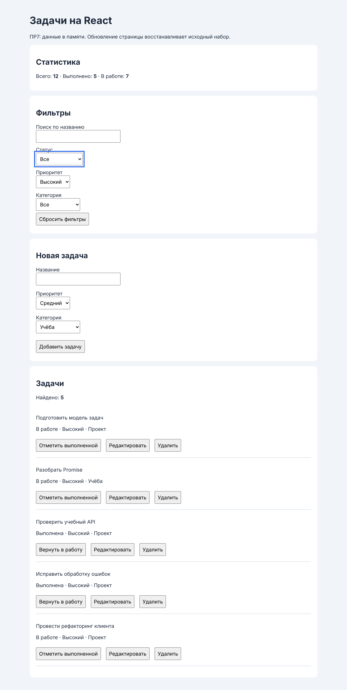

# ПР7. Создание компонентного интерфейса на React

- Автор: Бочко Никита Сергеевич
- Группа: ЭФБО-05-25
- Вариант: 3, начальный фильтр «Высокий приоритет»
- Node.js / npm: v22.23.4 / 10.9.9

## Запуск

Из папки `practice-07`: `npm ci`, затем `npm run dev`.
`package-lock.json` уже входит в заготовку.
Адрес по умолчанию: http://127.0.0.1:5173/.
Проверки: `npm test`. Сборка: `npm run build`. Просмотр сборки: `npm run preview` (порт 4173).

Папки `node_modules` и `dist` в репозиторий не попадают, они перечислены в `.gitignore`.

## Результат

Приложение на React и Vite выводит 12 задач из `src/data.js`, фильтрует их по четырём условиям, считает статистику, создаёт, редактирует, переключает и удаляет записи. Одна форма работает в двух режимах: создание и редактирование выбранной задачи. Все изменения выполняются неизменяемо, исходный набор заморожен через `Object.freeze`, а `App` пересоздаёт массив при инициализации.

Ограничение этой работы: данные живут только в памяти вкладки. Перезагрузка страницы возвращает исходные 12 задач и начальный фильтр варианта. Ни `localStorage`, ни сервер здесь не используются - это тема ПР8.

## Компоненты и состояние

| Что хранится | Где | Почему там |
|---|---|---|
| `tasks` | `App` | Массив нужен и списку, и статистике, и форме при редактировании |
| `filters` | `App` | Выборка считается в `App`, а `TaskFilters` только отображает текущие значения |
| `editingId` | `App` | Режим формы - общее состояние: удаление записи должно его сбрасывать |
| `message` | `App` | Результат последнего действия для области `role="status"` |
| `draft`, `errors`, `failure` | `TaskForm` | Это внутреннее состояние ввода, остальным компонентам оно не нужно |
| `categories` | не состояние | Справочник импортируется из `data.js` и не меняется |

Данные идут вниз через props, действия - вверх через функции. `TaskList` получает уже отфильтрованный массив и ничего не фильтрует сам; `TaskItem` получает готовое `categoryName` и три обратных вызова `onToggle(id)`, `onEdit(id)`, `onDelete(id)`; `TaskForm` получает `initialTask` и вызывает `onSave(value)`, который возвращает `true` или `false`.

Производные данные не хранятся в состоянии, а считаются при каждом рендере:

```jsx
const visibleTasks = selectTasks(tasks, filters);
const stats = getTaskStats(tasks);
const editingTask = tasks.find(task => task.id === editingId) ?? null;
```

Если бы выборка и статистика лежали в `useState`, их пришлось бы пересчитывать после каждого действия, и любое пропущенное место давало бы расхождение между списком и счётчиками. Отдельный `useEffect` для этого тоже не нужен: ничего внешнего здесь не происходит.

Статистика считается по полному `tasks`, а не по `visibleTasks` - поэтому при фильтре «Высокий» видно 5 карточек, а «Всего» остаётся 12.

## Неизменяемые обновления, ключи и сброс формы

Все семь предметных функций возвращают новые значения и не трогают аргументы. Для добавления используется `[...tasks, task]`, для удаления - `filter`, для изменения - `map` вместе с `{ ...task, ... }`. Копировать только массив недостаточно: без нового объекта записи `next[0].completed = true` изменил бы и исходный элемент, потому что ссылка осталась бы общей. Это же проверяется тестом «аргументы не изменяются при последовательности действий».

Для неизвестного id `updateTask`, `toggleTask` и `removeTask` возвращают тот же массив без исключения: действие просто не состоялось, и перерисовывать нечего.

Ключом карточки служит `task.id`, а не индекс: при удалении середины списка индексы сдвигаются, и React связал бы состояние чужого элемента с другой задачей. Ключ ставится на самом элементе внутри `map` и в компонент как prop не приходит.

Форма сбрасывается через ключ:

```jsx
<TaskForm key={editingId ?? 'new'} initialTask={editingTask} ... />
```

Начальное значение `useState(createDraft(initialTask, categories))` применяется только при монтировании. Смена ключа монтирует форму заново, поэтому при переходе от задачи A к задаче B черновик A не переносится, а после успешного редактирования `App` возвращает `editingId` в `null`, и форма сама становится формой создания.

Подтверждение удаления вызывается до `setTasks`, а не внутри функции обновления: в `StrictMode` React может вызвать её дважды, и `confirm` появился бы два раза. По той же причине следующий id считается чистой функцией от `previous` внутри обновления:

```jsx
setTasks(previous => addTask(previous, value, nextId(previous)));
```

Идентификатор берётся как максимум **полного** массива плюс 1. Длина массива не подходит: в наборе 12 задач, а `12 + 1 = 13` - уже занятый id. Максимум видимой выборки тоже не подходит: при фильтре «Низкий» он даёт 32, то есть меньше существующего 34. Оба случая закреплены собственным тестом.

## Индивидуальный вариант

Вариант 3: начальный фильтр «Высокий приоритет», сценарий - изменить приоритет видимой задачи на средний, карточка должна исчезнуть из выборки.

| Шаг | Действие | Ожидаемый результат | Фактический результат |
|---:|---|---|---|
| 1 | Открыть приложение | Фильтр «Высокий» выбран заранее, показаны только задачи высокого приоритета | Видны id `[4, 13, 16, 25, 34]`, «Найдено: 5», статистика 12 / 5 / 7, поле фильтра приоритета в значении `high` |
| 2 | Нажать «Редактировать» у задачи 13 | Форма заполняется данными задачи | «Редактирование задачи № 13», название «Разобрать Promise», приоритет «Высокий», категория «Учёба» |
| 3 | Сменить приоритет на «Средний» и сохранить | Карточка исчезает из выборки, общий счётчик не меняется | Видны id `[4, 16, 25, 34]`, «Найдено: 4», статистика осталась 12 / 5 / 7, сообщение «Задача обновлена.», форма вернулась в режим создания |
| 4 | Переключить фильтр на «Средний» | Изменённая задача появляется в новой выборке | Видны id `[1, 10, 13, 19, 28]` - задача 13 на месте |

Карточка пропала не потому, что задачу удалили, а потому что она перестала удовлетворять активному фильтру: `selectTasks` пересчитывается на том же рендере, где изменился массив. Сообщение в области `role="status"` позволяет отличить это от ошибки сохранения.

## Автоматизированные проверки

Фактический вывод `npm test`:

```text
  ...
1..34
# tests 34
# suites 0
# pass 34
# fail 0
# cancelled 0
# skipped 0
# todo 0
# duration_ms 40.290125
```

Фактический вывод `npm run build`:

```text
vite v7.3.6 building client environment for production...
transforming...
✓ 37 modules transformed.
rendering chunks...
computing gzip size...
dist/index.html                   0.42 kB │ gzip:  0.31 kB
dist/assets/index-D-qtpoMY.css    0.62 kB │ gzip:  0.39 kB
dist/assets/index-18S5b6B3.js   233.52 kB │ gzip: 72.90 kB
✓ built in 447ms
```

Из 34 проверок 28 входят в готовый `checks/domain.test.js`, остальные 6 - собственные, они описаны в разделе про дополнительное задание. Исправлять в предметных функциях ничего не пришлось: обязательный набор прошёл с первого запуска. Одну ошибку допустил в своей проверке - ожидал исключение там, где конфликта id на самом деле не возникает; разобрался и заменил случай на тот, где конфликт реален (расчёт id по длине массива).

Сборка завершается без ошибок и предупреждений, собранное приложение проверено через `npm run preview`.

## Ручные проверки

Все сценарии выполнены на собранном приложении (`npm run preview`). Перед каждым сценарием фильтры сбрасывались, если не указано иное.

| № | Сценарий | Ожидаемый результат | Фактический результат |
|---:|---|---|---|
| 1 | Сбросить фильтры после загрузки | 12 карточек; всего 12, выполнено 5, в работе 7 | id `[1, 4, 7, 10, 13, 16, 19, 22, 25, 28, 31, 34]`, «Найдено: 12», статистика 12 / 5 / 7 |
| 2 | Отправить название из пробелов | Ошибка у названия, массив не меняется, ввод сохраняется | «Название не должно быть пустым.», `aria-invalid="true"`, в поле остались те же пробелы, всего по-прежнему 12 |
| 3 | Отправить название из 100, затем из 101 символа | Первое принимается, второе отклоняется | После 100 символов всего стало 13 и «Задача добавлена.»; после 101 - «Название должно содержать не более 100 символов.», всего осталось 13 |
| 4 | Создать «  Новая задача  » | Пробелы убраны, задача в работе, форма очищена | Создана запись id 36 с названием «Новая задача», строка «В работе · Средний · Учёба», поле названия пустое |
| 5 | Отредактировать выполненную задачу | Новые поля сохранены, статус остаётся выполненным | Задача 1: «Изучить функции и замыкания», «Выполнена · Низкий · Учёба», форма вернулась в режим создания |
| 6 | Начать правку A, затем нажать «Редактировать» у B | Форма содержит данные B, черновик A не переносится | После правки задачи 4 и перехода к задаче 7 форма показывает «Редактирование задачи № 7» и её настоящее название |
| 7 | Изменить поля и отменить редактирование | Исходная запись не изменена, форма вернулась к созданию | Заголовок «Новая задача», сообщение «Редактирование отменено.», название задачи 7 осталось прежним |
| 8 | Дважды переключить статус | Статус и статистика вернулись к исходным значениям | 12 / 5 / 7 → 12 / 6 / 6 → 12 / 5 / 7 |
| 9 | Отказаться от удаления, затем подтвердить | После отказа запись остаётся; после подтверждения удаляется | После отказа задача 10 на месте, после подтверждения исчезла |
| 10 | Удалить редактируемую запись | Форма переходит в режим создания | После удаления задачи 13 заголовок «Новая задача», сообщение «Задача удалена.» |
| 11 | Применить все четыре фильтра | Показаны только записи, удовлетворяющие всем условиям | Поиск «про» + «В работе» + «Высокий» + «Проект» дали одну карточку id 34 |
| 12 | Ввести поиск без совпадений, затем сбросить | Показано пустое состояние, затем восстановлен весь текущий список | «По выбранным условиям задач нет.», после сброса снова весь текущий набор |
| 13 | Создать запись, не подходящую под фильтры | Общий счётчик вырос; карточка скрыта до смены фильтра | При фильтре «Высокий» создана задача низкого приоритета: «Найдено» осталось 4, всего выросло с 10 до 11, сообщение «Задача добавлена.» |
| 14 | Ввести название `` | Отображается буквальный текст, код не исполняется | `textContent` равен введённой строке, вложенных элементов 0, в разметке `&lt;img ...&gt;`, диалог не появился |
| 15 | Удалить все задачи, затем создать новую | Пустой список и нулевые счётчики; создание продолжает работать | После удаления всех: пустое состояние и 0 / 0 / 0; после создания - одна карточка с id 1 и 1 / 0 / 1 |
| 16 | Перезагрузить страницу | Восстановлены исходный набор и начальные фильтры варианта | Снова id `[4, 13, 16, 25, 34]`, «Найдено: 5», статистика 12 / 5 / 7, фильтр «Высокий» |
| 17 | Пройти форму и кнопки клавиатурой | Видимый фокус, понятные подписи, действия доступны без мыши | Tab проходит по полям фильтров, форме и кнопкам карточек, у всех полей есть связанные `label` и `id`, фокус подсвечен правилом `:focus-visible` |
| 18 | Выполнить сценарий варианта в preview | Поведение совпадает с dev-режимом | Весь протокол и сценарий варианта выполнены именно на сборке `npm run preview`, расхождений с dev-режимом нет |

В Console нет ошибок приложения, предупреждений об отсутствующих ключах и о переходе поля из uncontrolled в controlled. Единственная запись - `404` на `/favicon.ico`: значок страницы в заготовке не задан, к коду приложения это не относится.

## Дополнительное задание

Выполнено задание «собственные проверки последовательности создание → редактирование → удаление». Добавлен файл `checks/scenario.test.js` с шестью проверками; он подхватывается тем же `npm test` по маске `checks/*.test.js`.

| № | Проверка | Что подтверждает |
|---:|---|---|
| 1 | Полный цикл: валидация черновика, создание, правка, удаление | После цикла набор идентификаторов и статистика совпадают с исходными, а исходный массив не изменился |
| 2 | Редактирование не теряет статус, переключение не теряет правки | `updateTask` сохраняет `completed: true`, последующий `toggleTask` меняет только статус |
| 3 | Длина массива и максимум выборки не годятся как следующий id | `tasks.length + 1` равен 13 и даёт исключение, максимум выборки «Низкий» даёт 32 вместо 35 |
| 4 | Удалённый максимальный id переиспользуется без конфликта | После удаления 34 новая запись получает 32, все id остаются уникальными |
| 5 | Созданная запись видна только в подходящей выборке | Задача низкого приоритета не попадает в выборку «Высокий», но увеличивает общий счётчик |
| 6 | Удаление всех задач оставляет корректные пустые результаты | Пустые массив и статистика, создание после очистки снова даёт id 1 |

Третья проверка закрывает сразу две типичные ошибки из методички, а пятая показывает в чистых функциях ровно то поведение, которое вручную проверяется сценарием 13.

## Контрольные вопросы

1. **Чем JSX отличается от строки HTML?** JSX - это синтаксис, который собирается в вызовы создания элементов; он описывает, что показать, а не текст разметки. Поэтому `{task.title}` вставляется как текст и экранируется, а не как HTML - сценарий 14 это подтверждает. Атрибуты пишутся по правилам JavaScript: `className`, `htmlFor`, теги закрываются.

2. **Чем props отличаются от состояния?** Props приходят от родителя и внутри компонента не изменяются, состояние принадлежит самому компоненту и меняется через его setter. `tasks` - состояние `App` и props для `TaskList`; `draft` - состояние `TaskForm` и наружу не выходит.

3. **Почему изменение обычной переменной не заменяет `useState`?** Обычная переменная создаётся заново при каждом вызове функции-компонента и не переживает рендер, а её изменение ничего не сообщает React. `useState` и хранит значение между рендерами, и запускает повторный рендер.

4. **Когда требуется функциональная форма обновления?** Когда новое значение зависит от предыдущего. `setTasks(previous => toggleTask(previous, id))` работает с актуальным массивом, даже если обновлений несколько подряд, а `setTasks(toggleTask(tasks, id))` опирается на значение, захваченное при рендере, и может потерять изменение.

5. **Почему нельзя менять объект задачи внутри поверхностной копии массива?** Потому что `[...tasks]` копирует только сам массив, ссылки на объекты остаются общими. Правка через копию изменила бы и исходную запись, React не увидел бы нового объекта, а исходный набор оказался бы испорчен.

6. **Для чего списку стабильный `key`?** По ключу React сопоставляет элементы между рендерами. Индекс при удалении середины списка сдвигается, и состояние, связанное с одним элементом, досталось бы другому. `task.id` закреплён за записью и не зависит от позиции.

7. **Почему видимая выборка и статистика не хранятся в отдельных состояниях?** Это производные данные: их можно вычислить из `tasks` и `filters` на каждом рендере. Отдельное состояние пришлось бы синхронизировать после каждого действия, и забытое место давало бы расхождение между списком и счётчиками.

8. **Как дочерний компонент сообщает родителю о действии?** Через функцию из props: карточка вызывает `onToggle(task.id)`, а изменяет массив уже `App`. Сам ребёнок состояние родителя не трогает.

9. **Что делает поле управляемым?** `value` из состояния плюс `onChange`, который это состояние обновляет. Начальным значением должна быть строка: с `undefined` React сочтёт поле неуправляемым и предупредит при первом вводе.

10. **Почему `categoryId` из `select` требует преобразования?** Значение HTML-поля всегда строка, а в модели `categoryId` - число, и сравнение `task.categoryId === '2'` было бы ложным. Преобразование выполняется в `validateTaskDraft`, причём строгое: `'2x'` отклоняется, хотя `parseInt('2x')` вернул бы 2.

11. **Как меняется состояние формы при изменении её ключа?** React считает это другим компонентом: старый размонтируется, новый монтируется с начальным состоянием. Поэтому `key={editingId ?? 'new'}` сбрасывает черновик при переходе к другой задаче.

12. **Почему подтверждение удаления не помещается внутрь функции обновления?** Функция обновления должна быть чистой, а в `StrictMode` React в режиме разработки вызывает её дважды - окно подтверждения появилось бы два раза. `confirm` вызывается до `setTasks`, и при отказе состояние не трогается вовсе.

13. **Как отличить отсутствие задач от отсутствия совпадений фильтра?** По полной статистике: «Всего» считается по `tasks`, «Найдено» - по выборке. Если всего 12, а найдено 0, дело в фильтре; если оба нуля, задач нет совсем.

14. **Что проверяет `npm test` и чего он не проверяет?** Он проверяет чистые функции в Node.js: валидацию, фильтры, статистику и операции над массивом, включая неизменяемость аргументов. Он не проверяет React: рендер, ключи, управляемые поля, обработчики и доступность - это ручной протокол из раздела 9.3.

15. **Что потребуется изменить для подключения API в ПР8?** Предметные функции чтения и проверки в основном останутся, а операции изменения уедут на сервер. `onSave` станет асинхронным и вместо `true`/`false` будет возвращать промис, у действий появятся состояния ожидания и ошибки, а начальные данные придут из запроса, а не из `data.js`. Структура компонентов и владение состоянием при этом сохранятся.

## Вид приложения



Снимок сделан на сборке: фильтр «Высокий», задача 13 только что переведена в средний приоритет и исчезла из выборки, «Найдено: 4» при общей статистике 12 / 5 / 7.

## Вывод

Главное отличие от ПР3 и ПР4, где тот же список собирался руками: интерфейс больше не описывается последовательностью операций над DOM. Здесь описывается, как данные должны выглядеть, а приведением экрана в это состояние занимается React. Из-за этого изменилось и место ошибок: они переехали из «забыл обновить нужный узел» в «изменил массив вместо создания нового» и «сохранил производные данные в состоянии».

Удалось разобраться, где должно жить состояние и почему `tasks`, `filters` и `editingId` принадлежат `App`, а черновик формы - самой форме. Понятнее стала и роль ключей: `key` на карточке и `key` на форме решают разные задачи - первый связывает элемент списка с записью, второй намеренно сбрасывает состояние при смене редактируемой задачи.

Предметные функции прошли обязательные проверки с первого запуска, поэтому исправлять пришлось только одну собственную проверку, где я неверно предположил конфликт идентификаторов. При подключении API в ПР8 изменится слой действий: `onSave` станет асинхронным, появятся состояния ожидания и обработка отказов, а источником данных станет сервер - структура компонентов при этом останется прежней.
